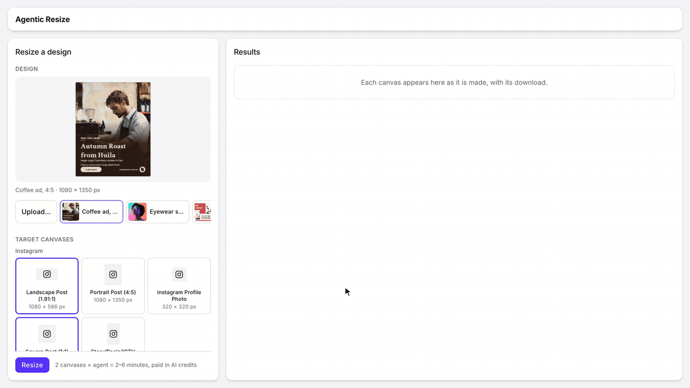

<p align="center">
  <a href="https://img.ly/static/agentic-resize.mp4"></a>
</p>

# Agentic Resize — an AI Design Resize Starter Kit

Agentic Resize is a TypeScript starter kit for resizing designs with AI, built
on IMG.LY's CoDesign SDK: a design agent on your server re-composes one design
for every canvas size you pick, such as a story, a square post or a web
banner, instead of stretching or cropping it. It is for teams that want a
resize feature or a resize API in their own product.

Watch the [demo video](https://img.ly/static/agentic-resize.mp4) (about 20 seconds).

Pick a design and some target sizes (a story, a banner, a header), and a
design agent re-composes the design for each one: it moves, scales and
re-flows the content instead of stretching it. Each result is a PNG to
download and a design you can keep editing in CE.SDK's editor. The page runs
in the browser; the agent and the design engine run on servers you start with
Docker Compose, the shape of a resize API in your product.

Use it as a starting point: copy the repo, keep what fits your product,
replace the rest. The guide for this kit is
[Agentic Resize](https://img.ly/docs/cesdk/codesign/starter-kits/agentic-resize-cdsars/).

Terms used below: **CE.SDK** is IMG.LY's design engine and editor. A
**design** is a CE.SDK scene, saved as an `.imgly` file. The **CoDesign SDK**
(`@imgly/codesign-sdk`) gives an AI model the tools to read, change, preview
and export designs. The **executor** is where those tools run a CE.SDK
engine: IMG.LY's published Docker image,
`imgly/codesign-executor:1.84.0`, which you run unchanged. The
**runner** is your server that runs the resize job and its agent loop with
those tools (`src/hosting/cloud/runner/`, a Node server).

## What you need

- Node.js 22 or newer, Docker with Compose, and a desktop browser (the page is
  tested in desktop Chrome).
- A **CE.SDK license key** for the editor in the page, the kind a CE.SDK web
  editor uses. A 30-day trial key works for local development:
  sign up in the [IMG.LY dashboard](https://img.ly/dashboard), which shows it.
  It goes in `VITE_CESDK_LICENSE`.
- A **CoDesign license key**, which pays for model calls and exports.
  [Contact sales](https://img.ly/forms/contact-sales/) to get a CoDesign license key. It goes in `.env`
  twice, under two names: `IMGLY_GATEWAY_API_KEY`, which the runner sends to
  IMG.LY's AI gateway, and `IMGLY_CESDK_LICENSE`, which the executors start
  with. It is not the CE.SDK key in `VITE_CESDK_LICENSE`.

## Run it

```sh
npm install
cat .env.template src/hosting/cloud/.env.template > .env
```

Fill in `.env`:

| Variable                                          | Value                                                                       |
| ------------------------------------------------- | --------------------------------------------------------------------------- |
| `VITE_CESDK_LICENSE`                              | the CE.SDK license key                                                      |
| `IMGLY_GATEWAY_API_KEY` and `IMGLY_CESDK_LICENSE` | the CoDesign license key, in both                                           |
| `EXECUTOR_TOKEN`                                  | any string: the token nginx adds to every request to the executors          |
| `RUNNER_DEV_USER`                                 | any id, for example `me`: on your machine, every request is this one person |

The other variables have working defaults for this machine. Then start the
containers (three executors behind nginx), the runner and the page:

```sh
docker compose -f src/hosting/cloud/compose.yaml --env-file .env up -d
npx vite-node src/hosting/cloud/runner/serve.ts   # the runner, http://127.0.0.1:8793
npm run dev                                       # the page, http://localhost:5191
```

With pnpm: `pnpm install`, `pnpm exec vite-node …` and `pnpm dev`. The page
opens on a coffee ad with two sizes picked; press Resize. Three more samples,
or an `.imgly` file or an image you upload, replace it. The target sizes are
CE.SDK's page and crop presets, plus a custom size. Each PNG and the model
calls are charged to your CoDesign license key.

Other scripts: `npm run check` (type-check), `npm run build:site` (the page
as a static site in `dist/`), `npm run preview` (serve that build),
`npm run build:runner` (the runner as one file, `dist/runner/serve.mjs`, see
below).

To run the runner in Compose too, run `npm run build:runner`, then add
`--profile runner` to the `docker compose` command: it starts the bundle in a
Node container beside the executors (your own server, not IMG.LY's image).
That runner listens on all addresses, and it refuses `RUNNER_DEV_USER` unless
it listens on a loopback address, so this path needs your sign-in's
`TOKEN_ISSUERS` (below).

## Read `src/runner/resize.ts` first

One file holds the job. For each size it opens a new design, loads the
original into it, lets the agent re-compose it with the CoDesign tools, and
exports an `.imgly` and a PNG, whose size in pixels is the canvas the card
reports:

```ts
// openDesign: the kit's one prepareCoDesign call
prepareCoDesign({
  conversation, // one per run: every size of the run opens on the same executor
  executors, // the executor containers
  plugins: [googleFonts()], // the fonts the designs may use
  gateway: false // no image generation: resizing makes nothing new
});

// per size, in resizeDesign
const { version } = await codesign.load(await readSource(source, readSample));
const report = await runAgent({
  tools: codesign.tools,
  systemPrompt: SYSTEM_PROMPT,
  instructions: codesign.instructions,
  prompt: resizePrompt(format, version)
});
const archive = await codesign.export('imgly');
const png = await codesign.export('png'); // charged; offered as a download too
```

## How it fits together

| Piece        | Here                                                                                | In your product                                |
| ------------ | ----------------------------------------------------------------------------------- | ---------------------------------------------- |
| The page     | `src/page/` and `index.html`, talking only to the runner                            | your web app, or any client of your API        |
| The runner   | `src/hosting/cloud/runner/`, a Node server: one job per request                     | your server, in any agent framework            |
| The model    | IMG.LY's AI gateway, called from the runner with `IMGLY_GATEWAY_API_KEY`            | the same gateway, from your server             |
| The tools    | `prepareCoDesign` in `src/runner/resize.ts`                                         | the same call on your server                   |
| The executor | the published image, three containers in `src/hosting/cloud/compose.yaml`           | the same image, one container per conversation |
| Storage      | none: the results come back to the page as bytes; the samples are `samples/*.imgly` | your bucket, if you keep results               |
| Sign-in      | a JWT whose issuer is in `TOKEN_ISSUERS`, or `RUNNER_DEV_USER` on your machine      | your sign-in                                   |

The job is `src/runner/`: `resize.ts`, and `serve.ts`, which turns each
request into `resizeDesign(...)` calls and reports every step. Where it runs is
`src/hosting/cloud/`. The page (`src/page/`) is the form, the results and
CE.SDK's editor for a result.

The page talks to the runner with the messages in `src/protocol.ts`: it sends
one job as `POST /runs` (a resize, or a preview of a source), and the answer
is a stream of JSON lines (each step of the agent, each file as it is kept,
each canvas as it lands), ending with the result. A file's bytes travel as
base64 (`src/hosting/cloud/runner/wire.ts`).

`shared/` is code this kit shares with the other CoDesign starter kit: the
page's session, the agent loop, the executor pool, the editor dialog and the
base styles. It is part of your copy; change it like the rest.

## Plug in your own sign-in

The page has no sign-in of its own, and the runner learns who calls from a
token. Two places change:

- **The page** sends the token that `startSession()` returns from `getToken`,
  in `shared/src/page/session.ts`. Return your sign-in's JWT there, a fresh one
  per call.
- **The runner** checks it in `src/hosting/cloud/runner/auth.ts`: a JWT whose
  issuer is in `TOKEN_ISSUERS`, with its keys at
  `<issuer>/.well-known/jwks.json` (or `JWKS_URL`; optional `TOKEN_AUDIENCE`,
  and `TOKEN_HEADER` when the token is not sent as `Authorization: Bearer`).
  The token is only for identity: the platform's key on the runner pays the
  model, not the person.

`RUNNER_DEV_USER` stands in for a sign-in on your machine. Set it or
`TOKEN_ISSUERS`, not both.

**Reuse what you have:** your sign-in and your API backend stay. The runner
needs your sign-in's issuer, to check its tokens, and the page needs to hand
it a token.

## What to know before you build on it

- **The executors need your CoDesign license key** (`IMGLY_CESDK_LICENSE`):
  they activate it when they start and charge every export to it
  ([billing](https://img.ly/docs/cesdk/codesign/deploy/host-the-executor-cdshst/#billing)).
- **Only the runner reaches the executors.** nginx adds their token
  (`EXECUTOR_TOKEN`) and refuses any request from a page, so no page can
  spend your licence through it.
- **Each executor serves one conversation:** a resize run is one, and each
  preview of an uploaded source another. An executor exits about 3½ minutes
  after its conversation's last call (3 idle minutes, then 30 seconds) and
  restarts empty, so three executors
  keep a run and two previews going; a fourth waits up to 60 s, then fails
  with a message. Add services to `compose.yaml` and URLs to `EXECUTOR_URLS`
  for more.
- **Nothing is kept.** A run's previews and results come back to the page as
  bytes and are shown as `data:` and `blob:` URLs, so a reload starts over;
  an edit in the editor is kept in the page too. To keep results across
  reloads or share their links, have the runner write them to a store of
  yours and send its URLs instead.
- **A run's results go only to the request that started it.** The runner
  finishes a run whose tab was closed, and its exports are charged, but
  nobody receives them.

## Deploy it

IMG.LY does not host this for you. To put it online:

- **The page** is a static site: set `VITE_RUNNER_URL` to the runner's public
  `https` address, run `npm run build:site` and serve `dist/`.
  `VITE_CESDK_LICENSE` is built into the page, as in any CE.SDK web editor, so
  anyone who opens the site can read it.
- **The runner** is your server: `npm run build:runner` and run
  `node dist/runner/serve.mjs` from `dist/runner/` (it reads the bundled
  sample from there) with the runner's variables
  (`src/hosting/cloud/.env.template`), `TOKEN_ISSUERS` set, and
  `ALLOWED_ORIGINS` listing your page's origin.
- **The executors** are IMG.LY's image, unchanged. In production, start a
  container per conversation and restrict its network, as
  [Host the Executor](https://img.ly/docs/cesdk/codesign/deploy/host-the-executor-cdshst/)
  describes; the executors here can reach the whole internet.

**Reuse what you have:** your container platform, your job queue and your
sign-in. The kit needs containers of IMG.LY's image, a server that holds your
key, and your sign-in's issuer.

## What it costs

- **Model calls** are paid in IMG.LY AI credits on the key the runner holds
  (`IMGLY_GATEWAY_API_KEY`). The page shows an estimate before a run and the
  list price after it.
- **Exports** (each PNG; the `.imgly` file and the previews are free) are
  charged to the CoDesign license key the executors run with: the executor
  counts every file it exports and charges it before it is delivered
  ([billing](https://img.ly/docs/cesdk/codesign/deploy/host-the-executor-cdshst/#billing)).
- **Your balance** is in your
  [IMG.LY dashboard](https://img.ly/dashboard/credit-balance). For prices,
  [contact sales](https://img.ly/forms/contact-sales/).

## The samples

`samples/*.imgly` are the four sample designs, each one page with every
image's size recorded: a 4:5 coffee ad and an A4 poster of a fictional
roastery, made for these kits, and an eyewear sale post and a 16:9 podcast
banner from IMG.LY's templates, images included. They ship under this
repository's license.

## License

IMG.LY's license, the same as the CoDesign SDK's: see `LICENSE.md`.
